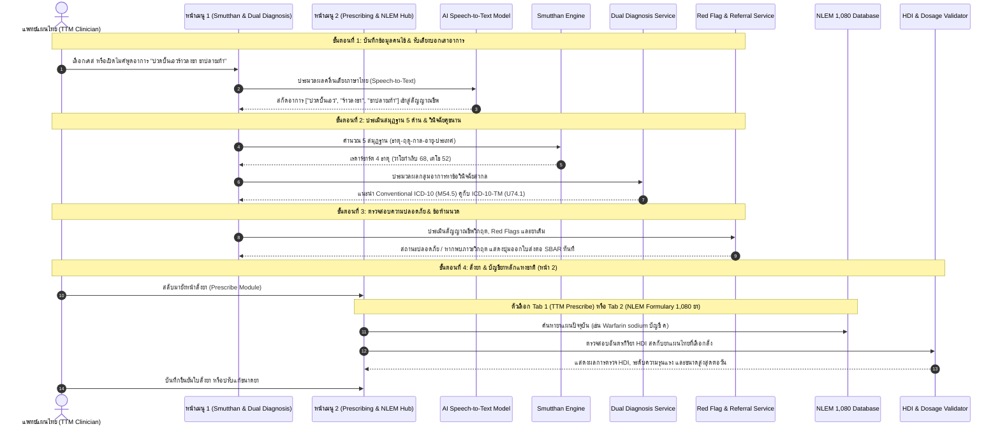

# สถาปัตยกรรมระบบและการเชื่อมต่อสารสนเทศ (System Architecture & HIS Integration)
**โครงการ:** TTM Smutthan Engine Platform — Hackathon 2026  
**ทีมพัฒนา:** **ทีม VejVivat (เวชวิวัฒน์) — Thai Medicine AI Innovation**  
**ลิงก์ระบบ Live Production:** [https://ttm-hackathon-2026.vercel.app](https://ttm-hackathon-2026.vercel.app)  
**ข้อความปฏิเสธความรับผิดชอบ:** *เอกสารนี้ใช้สำหรับข้อมูลสังเคราะห์เพื่อการสาธิตการแข่งขัน Hackathon 2026 เท่านั้น มิใช่ข้อมูลผู้ป่วยจริง*

---

## 1. แผนผังสถาปัตยกรรมระบบ (System Architecture)

แพลตฟอร์มถูกออกแบบด้วยสถาปัตยกรรม **Modular Clean Architecture & Hexagonal Adapter Pattern** ที่แยกส่วนการนำเสนอผล (Presentation Layer), ส่วนประมวลผลทางคลินิก (Core Clinical Domain Services), และส่วนเชื่อมโยงสารสนเทศ (HIS & Standards Layer):

```mermaid
graph TB
    subgraph ClientLayer ["1. Presentation Layer (Clinician-Facing UI)"]
        UI_Intake["Patient Intake Modal<br/>(New Registration & Live Weather)"]
        UI_Smutthan["หน้าเมนู 1: Smutthan & Dual Diagnosis<br/>(Voice STT / Radar / ICD-10 ↔ TM / Red Flag SBAR)"]
        UI_Prescribe["หน้าเมนู 2: Dual Formulary Hub<br/>(Tab 1: TTM Prescribe & HDI / Tab 2: NLEM 1,080 Drugs)"]
        UI_Print["Clinical Summary & SBAR Export<br/>(Printable Leaflet & SBAR Handover)"]
        UI_CarePlan["Care Plan & Trajectory Dashboard<br/>(Cadence Matrix & Recharts Trends)"]
        UI_Analytics["ICD-10-TM Real-time Analytics<br/>(Health Economics & Data Quality)"]
    end

    subgraph ServiceLayer ["2. Application & Core Domain Services"]
        SE["Smutthan Engine<br/>(5 Smutthan Factors Rule Scoring 0-100)"]
        STT["AI Speech-to-Text Service<br/>(Thai Audio NLP Tokenizer)"]
        DDS["Dual Diagnosis Service<br/>(ICD-10 ↔ ICD-10-TM Crosswalk)"]
        RFS["Red Flag Safety Service<br/>(Stroke / ACS / DVT / Massage Bans / SBAR)"]
        HDI["Two-Way Centralized HDI Matcher<br/>(Safety Rules C01-C30 & NLEM Cross-ref)"]
        HRS["Herb Recommendation Service<br/>(Element Balance & Symptom Match)"]
        DV["Dosage & Safety Validator<br/>(Max Daily Dose / Age limits)"]
        CPS["Care Plan & Follow-up Service<br/>(Monthly Cadence & Trajectory)"]
        AE["Analytics Engine<br/>(Cost per Episode / U-Codes)"]
        AI["AI Explainer Service<br/>(Clinical Note Synthesizer)"]
    end

    subgraph DataLayer ["3. Master Datasets & Local Persistence"]
        DB_Cases["30 Synthetic Cases (cases.json)<br/>Zero-PII Benchmarks C01-C30"]
        DB_TTM["TTM Formulary (thai-formulary.json)<br/>24-Digit Code / Taste / Primary Element"]
        DB_NLEM["NLEM Conventional Formulary (conventional-drugs.json)<br/>1,080 Drugs in 17 Clinical Systems"]
        DB_HDI["HDI Knowledge Base (herb-drug-interactions.json)<br/>Severity HIGH/MOD / Evidence A-D"]
        DB_ICD["Dual Diagnosis Master (icd10tm-master.json)<br/>ICD-10 ↔ ICD-10-TM U-Codes"]
        LocalStorage["Client-Side LocalStorage<br/>(Persistent Intake / Overrides / Rx)"]
    end

    subgraph AdapterLayer ["4. HIS Integration Layer (Adapter Pattern)"]
        Interface["HIS Adapter Interface"]
        MockAdap["Mock Local Adapter & Storage<br/>(In-Memory / LocalStorage Engine)"]
        Files43Adap["43-Folders Adapter<br/>(CSV Import/Export สนย. 2568)"]
        FhirAdap["HL7 FHIR Adapter<br/>(MedicationRequest JSON)"]
    end

    subgraph ExternalLayer ["5. External Systems & Data Sources"]
        HIS_HOSxP["HOSxP / HOSxP_PCU"]
        HIS_EHP["EHP (กรมการแพทย์แผนไทย)"]
        HIS_Other["SSB / Himpro"]
        MeteoAPI["Open-Meteo Weather API<br/>(Live Ambient Conditions)"]
    end

    UI_Intake --> MockAdap
    UI_Smutthan --> SE
    UI_Smutthan --> STT
    UI_Smutthan --> DDS
    UI_Smutthan --> RFS
    UI_Smutthan --> AI
    UI_Prescribe --> HRS
    UI_Prescribe --> HDI
    UI_Prescribe --> DV
    UI_Prescribe --> DB_NLEM
    UI_Print --> FhirAdap
    UI_CarePlan --> CPS
    UI_Analytics --> AE

    SE --> MeteoAPI
    UI_Intake --> MeteoAPI
    ServiceLayer --> Interface
    Interface --> MockAdap
    Interface --> Files43Adap
    Interface --> FhirAdap

    ServiceLayer --> DB_Cases
    ServiceLayer --> DB_TTM
    ServiceLayer --> DB_NLEM
    ServiceLayer --> DB_HDI
    ServiceLayer --> DB_ICD

    Files43Adap -.-> HIS_HOSxP
    Files43Adap -.-> HIS_EHP
    FhirAdap -.-> HIS_Other
```



---

## 2. ลำดับการไหลของข้อมูลทางคลินิก (Clinical Data Flow Diagram)



---

## 3. สถาปัตยกรรม Adapter Pattern สำหรับเชื่อมต่อ HIS

ระบบได้รับการออกแบบโดยยึดหลัก **Clean Architecture** และ **Hexagonal / Adapter Pattern** เพื่อให้สามารถเสียบต่อกับระบบ HIS ของโรงพยาบาลได้ทุกระบบโดยไม่ต้องแก้ไขโค้ดการทำงานหลัก:

```typescript
export interface HisAdapter {
  getPatientDemographics(hn: string): Promise<PatientInfo>;
  getActiveMedications(hn: string): Promise<CurrentMedication[]>;
  getEncounterVitals(vn: string): Promise<Vitals>;
  submitPrescription(prescription: PrescriptionSubmission): Promise<PrescriptionResponse>;
  exportFortyThreeFolders(dateRange: DateRange): Promise<Blob>;
}
```

### การรองรับระบบ HIS ในประเทศไทย:
1. **HOSxP / HOSxP_PCU:** เชื่อมต่อผ่าน MySQL Replication หรือ REST API Gateway ของ BMS
2. **EHP (Electronic Health Record กรมการแพทย์แผนไทย):** ส่งออกและนำเข้าข้อมูลประวัติการตรวจวินิจฉัยและรหัสยาแผนไทย
3. **SSB / Himpro:** เชื่อมต่อผ่าน HL7 FHIR MedicationRequest Endpoint
4. **Persistent LocalStorage Fallback:** บันทึกข้อมูลและเคสใหม่ที่ลงทะเบียนผ่าน `PatientIntakeModal` บนเบราว์เซอร์อย่างปลอดภัย พร้อมใช้งานแม้ออฟไลน์

---

## 4. โครงสร้างข้อมูล HL7 FHIR MedicationRequest Resource

ใบสั่งยาจากแพลตฟอร์มสามารถแปลงเป็นมาตรฐานสากล **HL7 FHIR R4 MedicationRequest** ได้ทันที:

```json
{
  "resourceType": "MedicationRequest",
  "id": "rx-c02-001",
  "status": "active",
  "intent": "order",
  "category": [
    {
      "coding": [
        {
          "system": "http://terminology.hl7.org/CodeSystem/medicationrequest-category",
          "code": "outpatient",
          "display": "Outpatient"
        }
      ]
    }
  ],
  "medicationCodeableConcept": {
    "coding": [
      {
        "system": "https://moph.go.th/standards/ttm/drug24",
        "code": "410000000122019150011402",
        "display": "ยาแคปซูลขมิ้นชัน"
      }
    ],
    "text": "ยาแคปซูลขมิ้นชัน (500 มก.)"
  },
  "subject": {
    "reference": "Patient/HN-2568002",
    "display": "นางสมจิตต์ (ข้อมูลสังเคราะห์เพื่อการสาธิต)"
  },
  "dosageInstruction": [
    {
      "text": "รับประทานครั้งละ 1 แคปซูล วันละ 3 ครั้ง หลังอาหาร เช้า-กลางวัน-เย็น",
      "timing": {
        "repeat": {
          "frequency": 3,
          "period": 1,
          "periodUnit": "d"
        }
      }
    }
  ],
  "note": [
    {
      "text": "Decision Support: แจ้งเตือนอันตรกิริยากับ Warfarin ความเสี่ยงสูง (Bleeding risk). แพทย์ยืนยันการสั่งใช้พร้อมนัดติดตาม INR สัปดาห์ละ 1 ครั้งตามแผนบริบาล VejVivat Care Plan"
    }
  ]
}
```

---

## 5. มาตรการความมั่นคงปลอดภัยและการปกป้องข้อมูลส่วนบุคคล (Security & Privacy)

1. **Zero Real Patient Data:** ระบบใช้ชุดข้อมูลสังเคราะห์ 30 เคส (C01–C30) ตามหลักวิชาการเวชกรรมไทย 100%
2. **PII Masking & De-identification:**
   - เลขบัตรประชาชนถูก Masked เป็น `1-1004-XXXXX-01-1`
   - เบอร์โทรศัพท์ถูก Masked เป็น `081-XXX-4501`
   - มีสคริปต์ตรวจสอบก่อน Commit (`scripts/check-pii.py`) รันผ่าน CI/CD ยืนยัน 0 PII
3. **Data Segregation:** ข้อมูลการคำนวณ กฎเกณฑ์ทางการแพทย์ และแดชบอร์ดถูกออกแบบให้ประมวลผลบน Client-side อย่างปลอดภัย ไม่ส่งข้อมูลระบุตัวตนออกนอกเบราว์เซอร์
