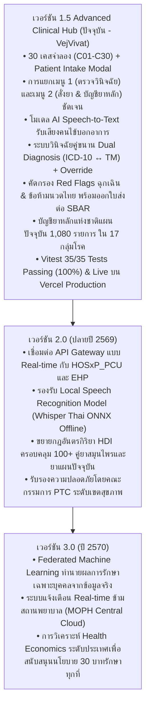

# ข้อจำกัดของระบบและแนวทางการพัฒนาต่อ (Known Limitations & Future Roadmap)
**โครงการ:** TTM Smutthan Engine Platform — Hackathon 2026  
**ทีมพัฒนา:** **ทีม VejVivat (เวชวิวัฒน์) — Thai Medicine AI Innovation**  
**ระดับความพร้อม:** **Maturity Level 1.5 — Advanced Clinical Hub & Dual Formulary Engine**  
**ลิงก์ระบบ Live Production:** [https://ttm-hackathon-2026.vercel.app](https://ttm-hackathon-2026.vercel.app)  
**ข้อความปฏิเสธความรับผิดชอบ:** *เอกสารนี้ใช้สำหรับข้อมูลสังเคราะห์เพื่อการสาธิตการแข่งขัน Hackathon 2026 เท่านั้น มิใช่ข้อมูลผู้ป่วยจริง*

---

## 1. ข้อจำกัดของระบบในเวอร์ชันปัจจุบัน (Current Limitations)

1. **การใช้ข้อมูลสังเคราะห์และการลงทะเบียนจำลอง (Synthetic Cohort & Intake Boundary):**
   - เคสจำลอง C01 ถึง C30 รวมถึงระบบลงทะเบียนผู้ป่วยใหม่ (`PatientIntakeModal`) ใช้ **ข้อมูลที่ถูกสังเคราะห์ขึ้นตามหลักวิชาการเวชกรรมไทยและเภสัชกรรมสมุนไพรเพื่อการสาธิตเท่านั้น** ข้อมูลถูกบันทึกบน LocalStorage และ Mock Adapters เพื่อการประเมินแบบ Zero-PII มิใช่เวชระเบียนจริงของกระทรวงสาธารณสุข
2. **ขอบเขตของโมเดล AI Speech-to-Text (Speech Recognition Boundary):**
   - การถอดรหัสเสียงทำงานผ่าน Web Speech API และ Web Audio API ของเบราว์เซอร์ หากอยู่ในสภาพแวดล้อมที่มีเสียงรบกวนสูง (Ambient Noise) หรือผู้ป่วยพูดสำเนียงภาษาถิ่น อาจทำให้การสกัดคำสำคัญคลาดเคลื่อนได้ โดยระบบมีช่องทางให้แพทย์ตรวจทานและพิมพ์แก้ไขอาการได้ตลอดเวลา
3. **ขอบเขตของระบบวินิจฉัยคู่ขนาน (Dual Diagnosis Recommendation Scope):**
   - ระบบแนะนำรหัสโรคคู่ขนาน ICD-10 สากล และ ICD-10-TM กลุ่ม U ทำหน้าที่เป็น **ระบบผู้ช่วยแนะนำ (Assistive Decision Support)** โดยอิงตามพจนานุกรมเทียบเคียงของกรมการแพทย์แผนไทยฯ (DTAM 2568) แพทย์ผู้ตรวจรักษายังคงเป็นผู้มีอำนาจตัดสินใจขั้นสุดท้ายและสามารถ Override รหัสโรคได้อิสระ
4. **ขอบเขตฐานข้อมูลยาแผนปัจจุบัน NLEM (1,080 Items Scope):**
   - ฐานข้อมูลยาแผนปัจจุบัน 1,080 รายการ ครอบคลุมประกาศบัญชียาหลักแห่งชาติฉบับทางการ (มี.ค. 2568) ใน 17 กลุ่มโรคสากล แต่ยานอกบัญชียาหลักแห่งชาติ (Non-NLEM) หรือยานำเข้าเฉพาะโรงพยาบาล แพทย์สามารถพิมพ์เพิ่มเข้าสู่ประวัติยาคนไข้ได้เองผ่านฟังก์ชัน Custom Medication
5. **แบบจำลองแนวโน้มการฟื้นฟู (Trajectory Model Assumptions):**
   - กราฟแนวโน้มระยะยาว (Longitudinal Trajectory) ในโมดูล Care Plan สร้างขึ้นจากการประมาณการณ์ทางคลินิก (Clinical Heuristic Model) อิงตามค่ามัธยฐานของการฟื้นฟูในเวชปฏิบัติแผนไทย ในสถานการณ์จริง จำเป็นต้องเก็บข้อมูลผลลัพธ์จริง (PROM/PREM) เพื่อปรับแต่งโมเดลการพยากรณ์ด้วย Machine Learning
6. **การคำนวณสภาพอากาศในร่ม (Microclimate vs Outdoor Weather):**
   - Open-Meteo API ให้ข้อมูลสภาพอากาศภายนอกอาคาร (Ambient Outdoor) แต่ผู้ป่วยอาจอาศัยอยู่ในห้องปรับอากาศ (Air Conditioning) ซึ่งอาจทำให้อุณหภูมิและเสมหะสมุฏฐานจริงเบี่ยงเบนไปจากค่าพยากรณ์

---

## 2. สถานะทางกฎหมายและการกำกับดูแล (Regulatory Status & Compliance)

- **Clinical Decision Support System (CDSS):**
  - แพลตฟอร์มนี้จัดเป็น **ระบบสนับสนุนการตัดสินใจทางคลินิก (CDSS)** มิใช่อุปกรณ์วินิจฉัยโรคอัตโนมัติ (Automated Diagnostic Device)
  - ความรับผิดชอบในการตรวจร่างกาย วินิจฉัย สั่งจ่ายยา การนวดทำหัตถการ และการออกใบส่งต่อฉุกเฉิน ยังคงเป็นของ **ผู้ประกอบวิชาชีพการแพทย์แผนไทยและแพทย์ผู้มีใบอนุญาต** อย่างสมบูรณ์
- **แนวทางซอฟต์แวร์ทางการแพทย์ (Software as a Medical Device - SaMD):**
  - ในการนำไปใช้งานจริงเชิงพาณิชย์หรือในโรงพยาบาล จะต้องดำเนินการยื่นขอการรับรองมาตรฐาน SaMD ตามประกาศของสำนักงานคณะกรรมการอาหารและยา (อย.) และผ่านการรับรองความปลอดภัยทางสารสนเทศ (ISO 27001 / PDPA)

---

## 3. แผนการพัฒนาในอนาคต (Future Roadmap)

